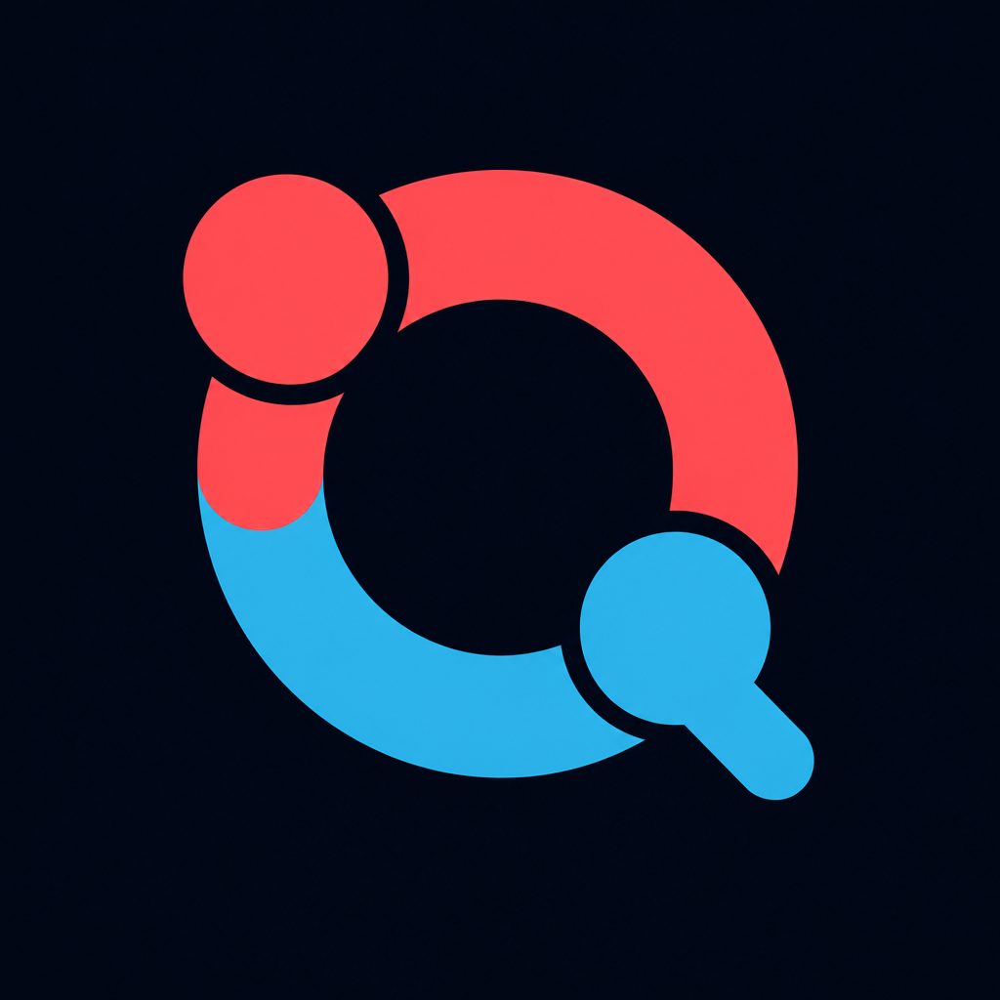
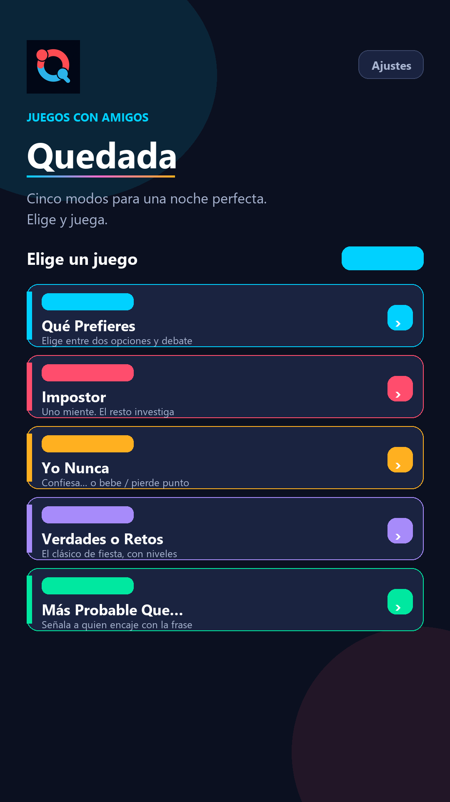
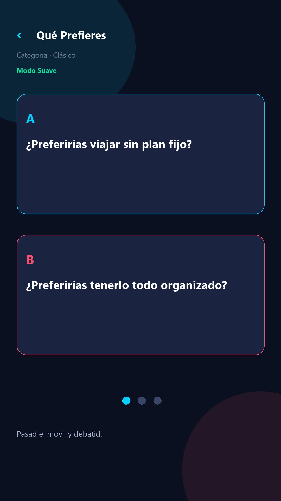
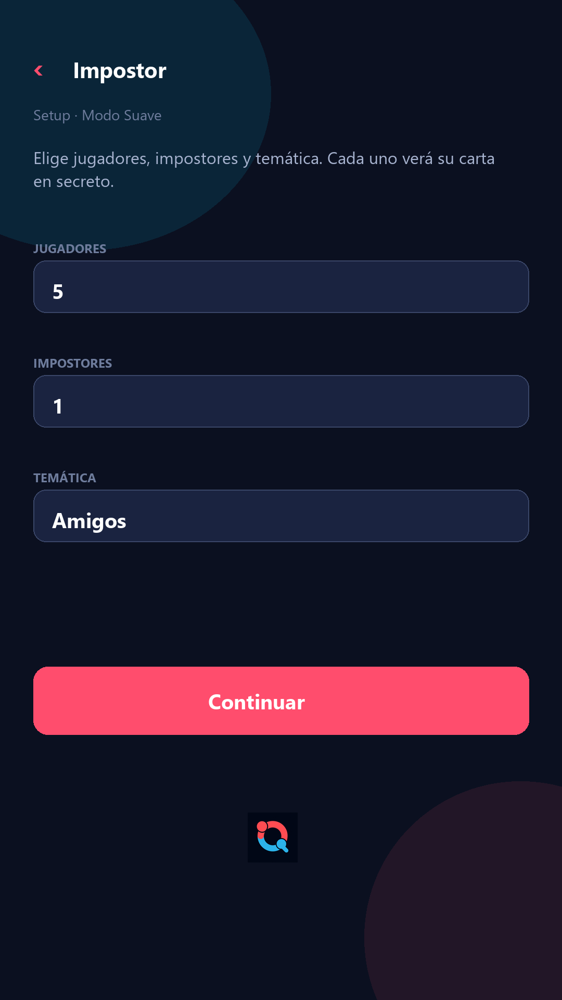
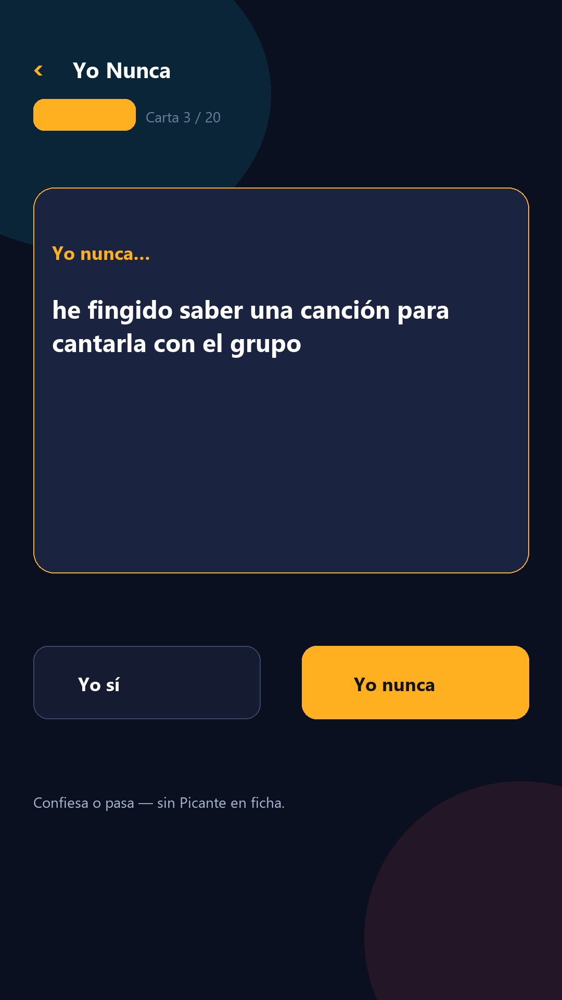
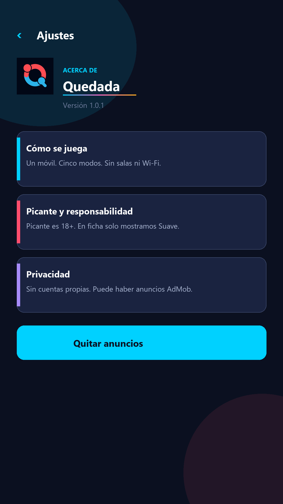

# Quedada

<p align="center">
  
</p>

<p align="center">
  <strong>La noche se alarga. El móvil pasa de mano en mano.</strong><br />
  Juegos de fiesta para cuando falta plan… o sobra aburrimiento.
</p>

<p align="center">
  
  
  
  
</p>

---

## La idea

Quedada nace de esas noches de verano con amigos en las que no hay plan… o de quedarte en casa sin saber qué hacer.  
**Cinco juegos clásicos de fiesta, en un solo móvil.** Sin salas, sin cuentas, sin Wi‑Fi obligatorio: abrís la app y empezáis.

Hoy el foco es **Android / Google Play**. App Store queda en el horizonte.

---

## Juegos

| Juego | En una frase |
|------|----------------|
| **Qué Prefieres** | Dos opciones. Elegís. Debatís. |
| **Impostor** | Uno miente. El resto investiga. |
| **Yo Nunca** | Confiesa… o bebe / pierde punto. |
| **Verdades o Retos** | El clásico, con niveles. |
| **Más Probable Que…** | Señalá a quien encaje con la frase. |

Hay contenido **Suave** (apto para ficha y capturas) y **Picante** (**18+**). El modo Picante no se muestra en materiales de tienda.

---

## Capturas (modo Suave)

Mockups de marca alineados con la UI oscura de la app (logo real). Ideal para docs y como base de ficha; se pueden sustituir por capturas del móvil cuando toque publicar.

| Home | Qué Prefieres | Impostor |
|:---:|:---:|:---:|
|  |  |  |

| Yo Nunca | Ajustes |
|:---:|:---:|
|  |  |

Detalle y checklist: [`store/screenshots/README.md`](store/screenshots/README.md)

---

## Stack

- **Expo SDK 58** + **React Native**
- Pantallas propias (sin router): Home, juegos, Ajustes
- Monetización nativa en builds EAS (`react-native-google-mobile-ads`, `react-native-iap`)
- En **Expo Go**: la app corre; anuncios/IAP van con stubs (sin SDKs nativos)

---

## Arrancar en local

```bash
npx expo start -c --go
```

En la terminal debe salir **`Using Expo Go`**. Abrí **Expo Go** en el móvil (misma Wi‑Fi) y escaneá el QR **desde la app**.

Tras cambios de monetización, reiniciá Metro con caché limpia (`-c`).

---

## Publicar en Google Play

Guía paso a paso (AdMob, EAS, ficha, IAP, revisión):

**[`store/launch-guide.es.md`](store/launch-guide.es.md)**

También: [`store/play-console-checklist.md`](store/play-console-checklist.md) · [`store/smoke-test.md`](store/smoke-test.md) · [`store/play-listing.es.md`](store/play-listing.es.md)

### Estado

- [x] App Expo + 5 modos + contenido
- [x] Branding (logo / icono / splash / feature graphic)
- [x] Política de privacidad (URL pública)
- [x] Monetización equilibrada en código (interstitials + IAP `remove_ads`)
- [x] Mockups Suave en `store/screenshots/`
- [ ] Variables AdMob reales en EAS + AAB production al día
- [ ] Capturas reales de dispositivo en la ficha Play
- [ ] Completar ficha + IAP + enviar a revisión

---

## Monetización (alto nivel)

Sin banners. Solo **interstitials** en momentos naturales (fin de ronda; en Verdades/Retos cada ~10 cartas), con **cooldown ~3 min** para no saturar.

Compra única **Quitar anuncios** (`remove_ads`) desde Ajustes. IDs reales de AdMob van por variables de entorno / EAS — **nunca en el repo**. Ver [`.env.example`](.env.example) y [`store/monetization.md`](store/monetization.md).

---

## Privacidad y 18+

- Sin cuentas propias ni backend de usuarios.
- Puede haber publicidad de Google (AdMob) en builds nativos.
- Política: https://ivanmarrtin2703.github.io/quedada-privacy/
- **Picante = solo mayores de edad.** Declaralo en Play; no uses Picante en capturas de la ficha.

---

## Licencia / contacto

Proyecto privado de producto · Soporte: `ivanmarrtin2703@gmail.com`
